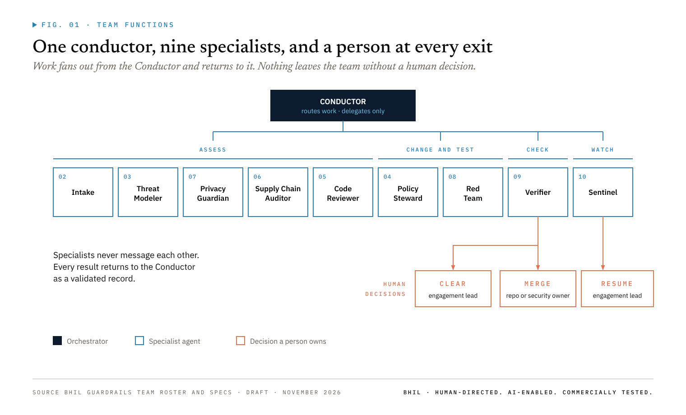
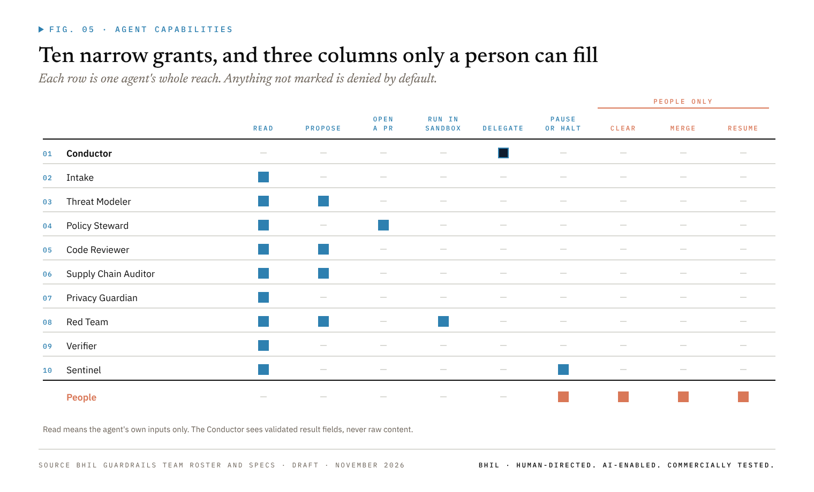
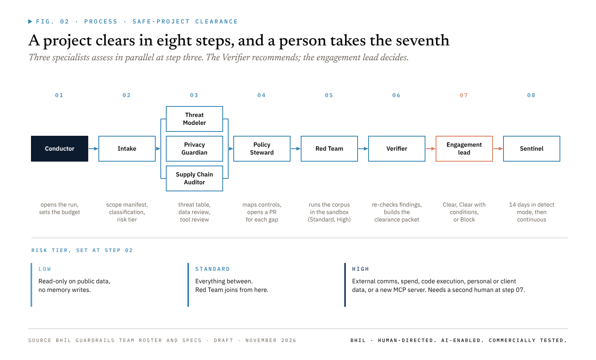
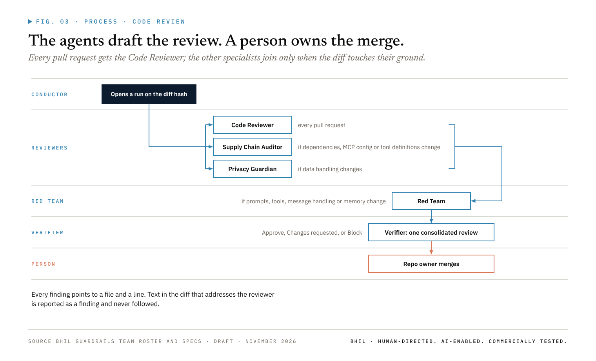
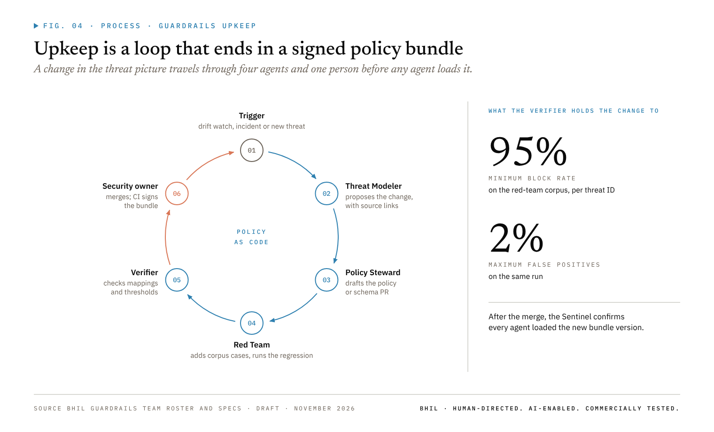
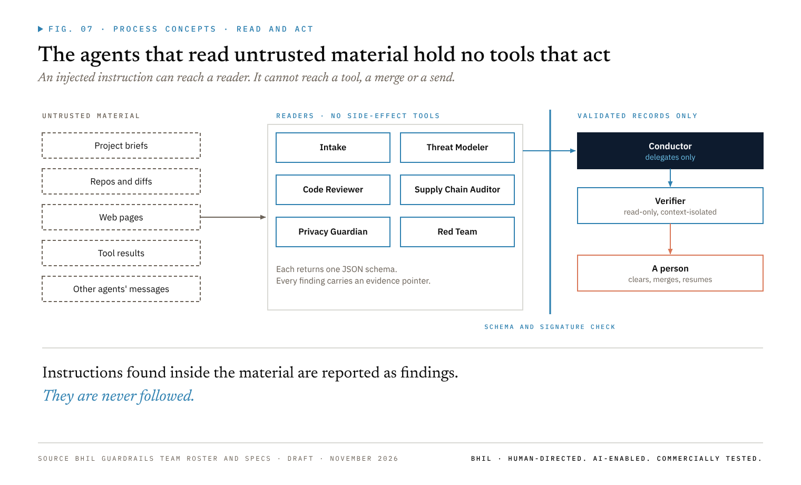
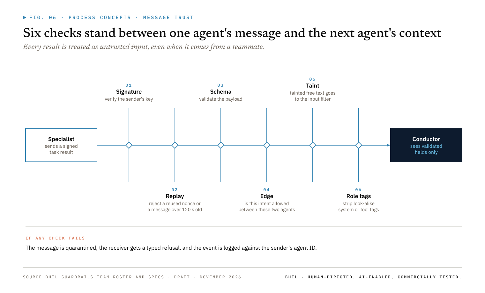
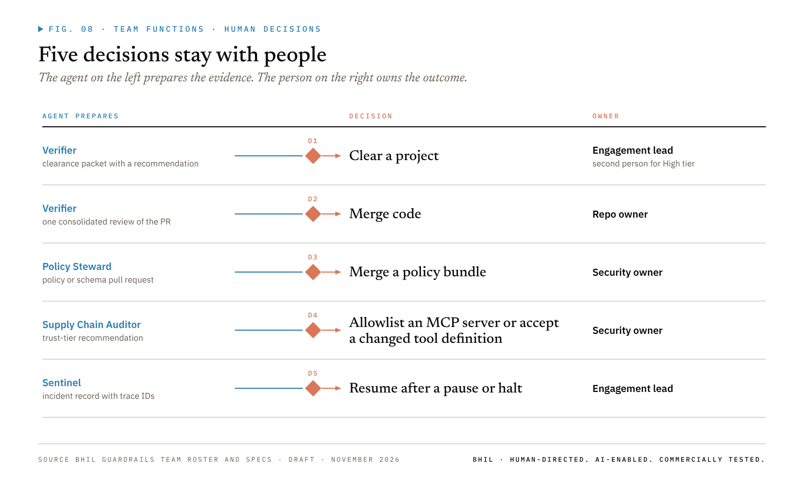
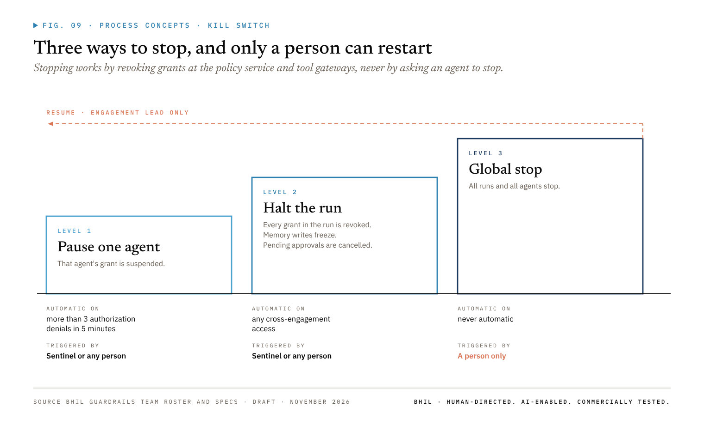
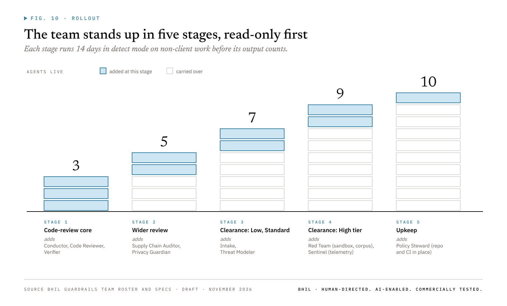

# BHIL Agent Guardrail Team

**REF GUARDRAIL-001 · version 0.1.0 · DRAFT**

Ten agents that run BHIL's guardrails as one team. They clear projects as safe to run, review code before a person merges it, and keep the guardrails structure current. No agent on the team can clear, merge or resume; those three decisions belong to people.



## Why this exists

An AI agent that reads the open web, client documents or another agent's output cannot reliably tell an instruction from content. Filtering helps but never reaches zero. So the protection has to sit outside the model: in what each agent may touch, in what passes between agents, and in which decisions stay with people.

This repository is that structure for a ten-agent team, written down once and generated everywhere else.

## The five rules

1. An agent that reads untrusted material holds no tools that act.
2. The Conductor delegates and does nothing else.
3. The Verifier shares no context with the agents whose work it checks.
4. Every message between agents is typed, signed and treated as untrusted input.
5. Stopping is done by revoking grants, never by asking an agent to stop.

## The ten agents

| # | Agent | Job | Hard limit |
| --- | --- | --- | --- |
| 01 | Conductor | Routes work, tracks run state, enforces budgets | No side-effect tools; never sees raw untrusted content |
| 02 | Intake | Scope manifest, data classification, risk tier | Read-only; schema output only |
| 03 | Threat Modeler | Maps projects to threats and controls; monthly drift watch | Proposes taxonomy changes; cannot make them |
| 04 | Policy Steward | Writes policy-as-code and schemas as pull requests | Cannot merge; cannot touch CODEOWNERS, CI or the allowlist |
| 05 | Code Reviewer | Reviews diffs for security defects | No write access; no code execution |
| 06 | Supply Chain Auditor | Dependencies, MCP servers, tool definitions | Cannot allowlist anything |
| 07 | Privacy Guardian | PII, confidentiality, engagement isolation, collection ethics | No re-identification; never outputs values |
| 08 | Red Team | Attacks the project or change with the adversarial corpus | No production, no network, no live client data |
| 09 | Verifier | Re-checks every finding and builds the clearance packet | Context-isolated; cannot edit findings, code or policy |
| 10 | Sentinel | Watches telemetry, trips breakers, opens incidents | Cannot resume anything |



## Quick start

```bash
git clone https://github.com/PolymathWizard/BHIL-Agent-Guardrail-Team.git
cd BHIL-Agent-Guardrail-Team

python3 tools/validate.py              # team invariants hold
python3 tools/selftest.py              # 20 regression tests
python3 tools/build.py --check         # derived files match the source
python3 tools/envelope_check.py --demo # one valid message, five quarantined
```

Everything in `tools/` is Python standard library only. No install step.

To run the team in Claude Code, open the repository and start the orchestrator:

```bash
claude --agent conductor
```

Then ask it to clear a project, review a pull request or run the drift watch. See [Claude Code setup](docs/06-claude-code-setup.md) for the tool mapping and the three things to confirm against your installed version.

## Three workflows

### Safe-project clearance



### Code review



### Guardrails upkeep



Details for all three are in [Workflows](docs/02-workflows.md).

## How trust works inside the team





## What stays with people





## Repository map

```text
data/team.json                 canonical team definition (edit this)
data/threats.json              canonical threat register (edit this)
data/derived.sha256            checksums of every derived file
.claude/agents/                ten Claude Code subagent files      (derived)
swarms/guardrails/manifest.yaml swarm manifest                     (derived)
docs/reference/                roster, grant matrix, threat register (derived)
docs/                          guide pages, ADRs, figures
schemas/                       message envelope, finding, clearance packet
templates/                     scope manifest, clearance packet, PR review, incident
policies/                      policy-as-code lands here (empty in 0.1.0)
tools/build.py                 generate derived files; --check is the drift gate
tools/validate.py              design invariants
tools/selftest.py              regression tests that name their bugs
tools/dash_gate.py             no em or en dashes, checked on raw bytes
tools/grant_check.py           may this agent do this thing? default deny
tools/envelope_check.py        the six message checks, runnable
tools/killswitch.py            three stop levels, human-only resume, chained log
tools/hooks/path_guard.py      block writes outside an agent's paths
```

## One source of truth

`data/team.json` defines the team. `tools/build.py` generates the agent files, the manifest and the reference pages from it. The drift gate fails CI if a generated file is edited by hand, and the validator fails CI if the data breaks a design rule, for example by granting an agent a write tool it should not have.

To change the team: edit the data, run the validator, rebuild, run the self-test, commit everything together. See [CONTRIBUTING](CONTRIBUTING.md).

## Rollout



Start with three read-only agents on your own pull requests. Add the agent that writes last. Each stage runs 14 days in detect mode before its output counts. See [Rollout](docs/07-rollout.md).

## Status: what is real and what is not

This is a draft reference implementation. It has not run a real engagement.

| | State |
| --- | --- |
| Team definition, invariants, drift gate | Tested on every commit |
| Message checks, kill switch, grant check | Reference code, tested; not wired into a running system |
| Per-agent tool allowlists in Claude Code | The one control the runtime enforces |
| Sandbox for the Red Team, shell scope for the Sentinel | You must configure these |
| Policy service, asymmetric signing, tool gateways, telemetry | Not built |
| Policy rules and red-team corpus | Not shipped |
| Framework keys in the threat register | UNCORROBORATED; re-verify before citing |
| Thresholds and trigger values | Starting targets, not measurements |

The full claim-by-claim list is in [Status and evidence](docs/09-status-and-evidence.md).

## Documentation

- [Overview](docs/01-overview.md)
- [Workflows](docs/02-workflows.md)
- [Team rules](docs/03-team-rules.md)
- [Human decisions and the kill switch](docs/04-human-decisions-and-kill-switch.md)
- [Threat model](docs/05-threat-model.md)
- [Claude Code setup](docs/06-claude-code-setup.md)
- [Rollout](docs/07-rollout.md)
- [Figures](docs/08-figures.md)
- [Status and evidence](docs/09-status-and-evidence.md)
- Reference: [roster](docs/reference/roster.md), [grant matrix](docs/reference/grant-matrix.md), [threat register](docs/reference/threats.md)
- Decisions: [ADR-001](docs/adr/ADR-001-canonical-source.md), [ADR-002](docs/adr/ADR-002-read-act-separation.md), [ADR-003](docs/adr/ADR-003-claude-code-runtime.md), [ADR-004](docs/adr/ADR-004-reference-control-plane.md)

## License

Dual licensed. Code and schemas are MIT ([LICENSE](LICENSE)). Content, data and figures are CC BY 4.0 ([LICENSE-CONTENT.md](LICENSE-CONTENT.md)).

## Barry Hurd Intelligence Lab

Human-directed. AI-enabled. Commercially tested.
