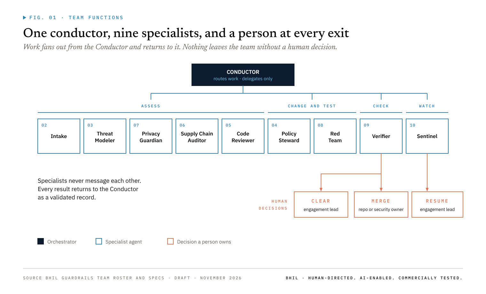
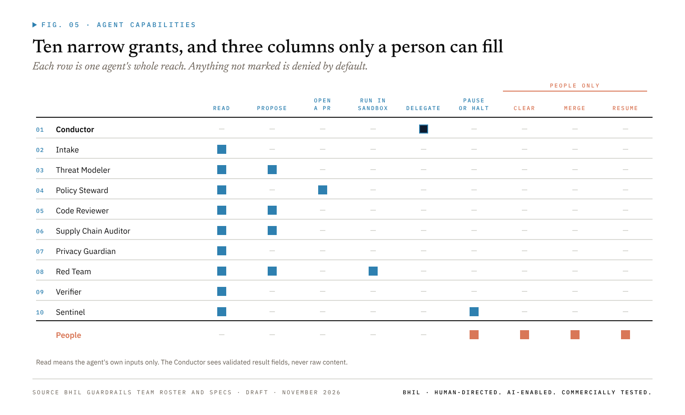

# Overview

## What the team is for

BHIL builds and operates AI agents and multi-agent swarms for research, intelligence and client deliverables. Those agents read the open web, ingest client documents and write to shared memory. An agent in that position cannot reliably tell an instruction from content, so the protection has to sit outside the model: in what each agent is allowed to touch, in what passes between agents, and in which decisions stay with people.

The Guardrail Team is the group of agents that applies that protection to every other BHIL project. It does three things.

| Job | Trigger | Ends with |
| --- | --- | --- |
| Safe-project clearance | A person submits a project request | The engagement lead clears, clears with conditions, or blocks |
| Code review | A pull request opens | The repo owner merges or sends it back |
| Guardrails upkeep | Monthly drift watch, an incident, or a new threat | The security owner merges a signed policy bundle |

## The ten agents

| # | Agent | Job |
| --- | --- | --- |
| 01 | Conductor | Routes work, tracks run state and enforces budgets |
| 02 | Intake | Turns a project request into a scope manifest, data classification and risk tier |
| 03 | Threat Modeler | Maps the project to BHIL-T threats and required controls; runs the drift watch |
| 04 | Policy Steward | Writes policy-as-code and schemas as pull requests |
| 05 | Code Reviewer | Reviews diffs for security defects |
| 06 | Supply Chain Auditor | Checks dependencies, MCP servers and tool definitions |
| 07 | Privacy Guardian | Checks PII handling, client confidentiality, engagement isolation and collection ethics |
| 08 | Red Team | Attacks the project or change with the adversarial corpus |
| 09 | Verifier | Re-checks every finding independently and builds the clearance packet |
| 10 | Sentinel | Watches telemetry, trips breakers and opens incidents |

The full specification for each agent, including its instructions, is in the [roster reference](reference/roster.md). What each one may and may not do is in the [grant matrix](reference/grant-matrix.md).

## How the agents are grouped

- **Assess:** Intake, Threat Modeler, Privacy Guardian, Supply Chain Auditor, Code Reviewer. They read material and report findings.
- **Change and test:** Policy Steward, Red Team. One proposes policy changes; the other tries to break things inside a sandbox.
- **Check:** Verifier. It reproduces findings from evidence without seeing how the others reasoned.
- **Watch:** Sentinel. It reads telemetry and can pause an agent or halt a run.

The Conductor sits above all four groups. It assigns tasks and receives validated results. It has no other tool.

## What a person always owns

No agent can clear a project, merge anything, or resume a run that was paused or halted. Those three capabilities do not appear in any agent's grant, and the validator fails the build if one is added.

## What this repository contains

| Path | What it is |
| --- | --- |
| `data/team.json` | The canonical team definition. The only file to edit when the team changes |
| `data/threats.json` | The sixteen-threat register with framework keys |
| `.claude/agents/` | Ten Claude Code subagent files, generated |
| `swarms/guardrails/manifest.yaml` | The swarm manifest, generated |
| `schemas/` | JSON Schemas for the message envelope, a finding and the clearance packet |
| `templates/` | Scope manifest, clearance packet, pull request review and incident record |
| `tools/` | Stdlib-only Python: build, validate, drift gate, dash gate, grant check, envelope check, kill switch, self-test |
| `docs/` | This site, including ten figures |
| `docs/adr/` | Architecture decision records with their open questions |

## What this repository is not

It is a reference implementation of the team's rules, not a finished control plane. The message signing in `tools/envelope_check.py` uses a shared-key stand-in. The kill switch writes a local state file that a harness must choose to read. In Claude Code today, the part that is actually enforced is each agent's tool allowlist. [Status and evidence](09-status-and-evidence.md) says exactly which claims are tested and which are design intent.
