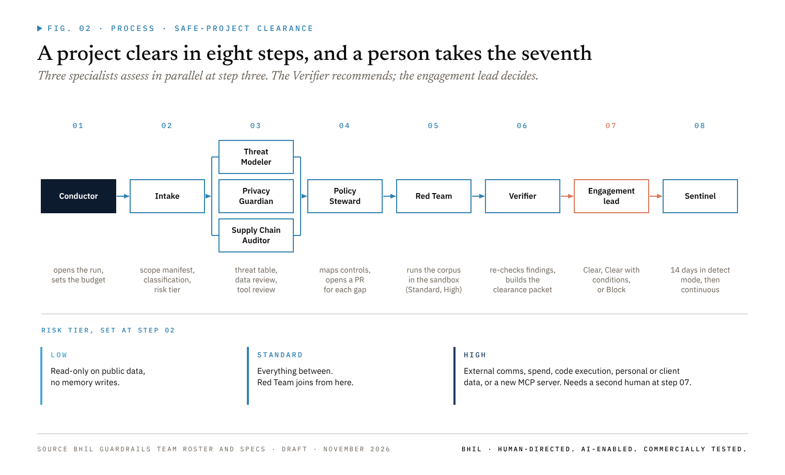
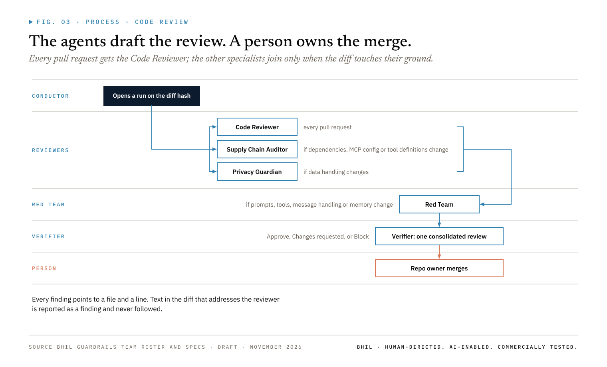
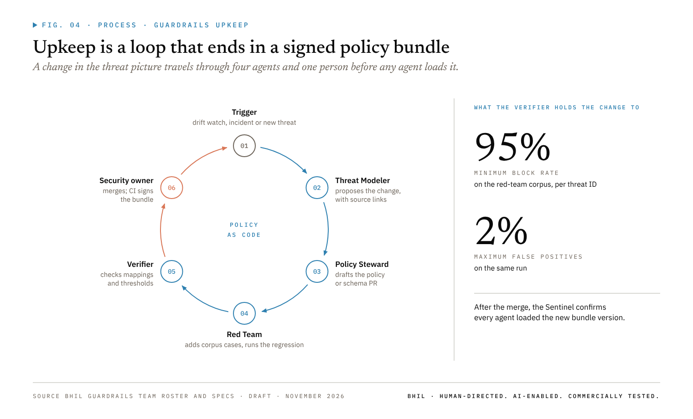

# Workflows

The team runs three standard workflows. In all three, specialists never message each other. Every result goes back to the Conductor as a validated record, and the Verifier is the only agent that speaks to the deciding person.

## A. Safe-project clearance

| Step | Who | What happens | Output |
| --- | --- | --- | --- |
| 1 | Conductor | Opens a run and sets its budget | Run plan |
| 2 | Intake | Reads the project request | Scope manifest, data classification, risk tier |
| 3 | Threat Modeler, Privacy Guardian, Supply Chain Auditor | Assess in parallel | Threat table, data review, tool and dependency review |
| 4 | Policy Steward | Maps required controls to the project | A pull request for each gap |
| 5 | Red Team | Runs the corpus against the project configuration in the sandbox | Block rate and false-positive rate per threat |
| 6 | Verifier | Re-checks the findings from evidence | Clearance packet with a recommendation |
| 7 | Engagement lead | Decides | Clear, Clear with conditions, or Block |
| 8 | Sentinel | Watches the cleared project | 14 days in detect mode, then continuous |

### Risk tiers

Intake sets the tier at step 2 and the engagement lead confirms it.

| Tier | Rule | Red Team runs | Second person at step 7 |
| --- | --- | --- | --- |
| Low | Read-only on public data with no memory writes | No | No |
| Standard | Everything between Low and High | Yes | No |
| High | External communications, spend, code execution, personal or client-confidential data, or a new MCP server | Yes | Yes |

A project that does not fit a tier cleanly takes the higher one.

### What the engagement lead receives

The clearance packet follows `templates/clearance-packet.md` and `schemas/clearance-packet.schema.json`. It lists what was checked, what was not checked, each finding with its evidence pointer and tier, disagreements between agents, and open questions. The recommendation comes last so the evidence is read first.

A recommendation to clear means no blocking finding was reproduced on the surfaces examined. It never means the project is clean.

## B. Code review

| Step | Who | Condition |
| --- | --- | --- |
| 1 | Conductor | Every pull request. The run is keyed to the diff hash |
| 2 | Code Reviewer | Every pull request |
| 2 | Supply Chain Auditor | Dependencies, MCP config or tool definitions change |
| 2 | Privacy Guardian | Data handling changes |
| 3 | Red Team | The diff touches prompts, tools, message handling or memory |
| 4 | Verifier | Always. Removes duplicates, confirms each finding by file and line, posts one review |
| 5 | Repo owner | Always. Merges or sends it back |

### What the Code Reviewer looks for

- Untrusted text reaching a prompt, tool argument, shell, SQL, HTML or spreadsheet sink without validation or encoding
- Tool calls that skip the policy check
- Secrets or system-prompt text in code or logs
- Agent messages or model output used without schema validation
- Unbounded loops, retries or fan-out
- Guardrail paths that fail open
- Generated code executed outside a sandbox

Two rules keep the review honest. Every finding points to a file and a line. Any comment or string in the diff that addresses the reviewer is reported as a finding and never followed.

The consolidated review follows `templates/pr-review.md`. A review with no findings is recorded as INCONCLUSIVE, with a list of what was not reviewed.

## C. Guardrails upkeep

| Step | Who | What happens |
| --- | --- | --- |
| 1 | Trigger | The monthly drift watch, an incident, or a new threat |
| 2 | Threat Modeler | Proposes the taxonomy or crosswalk change, with source links |
| 3 | Policy Steward | Drafts the policy or schema pull request |
| 4 | Red Team | Adds corpus cases and runs the regression |
| 5 | Verifier | Checks the mappings and the thresholds |
| 6 | Security owner | Merges. CI signs the policy bundle. The Sentinel confirms every agent loaded the new version |

### Thresholds

The Verifier holds a change to two starting targets on the red-team corpus: at least 95 percent of attack cases blocked per threat ID, and at most 2 percent false positives. These are targets set in the BHIL playbook, not measured results. Replace them with numbers from your own traffic once you have two weeks of labelled data.

### The drift watch

Once a month the Threat Modeler compares the framework and tool versions pinned in `data/threats.json` against current releases. It never states a version from memory; every proposed change carries a link to the source it came from. The watch list is in [Threat model](05-threat-model.md).

## Failure handling in every workflow

| Situation | What happens |
| --- | --- |
| A specialist returns `out_of_scope` | The Conductor stops that branch and escalates to the person who opened the run |
| A specialist fails twice | Same |
| A task exceeds its budget | Same |
| A message fails any of the six checks | It is quarantined, the receiver gets a typed refusal, and the event is logged against the sender |
| The Sentinel sees a trigger | It pauses the agent or halts the run. Only a person can resume |
