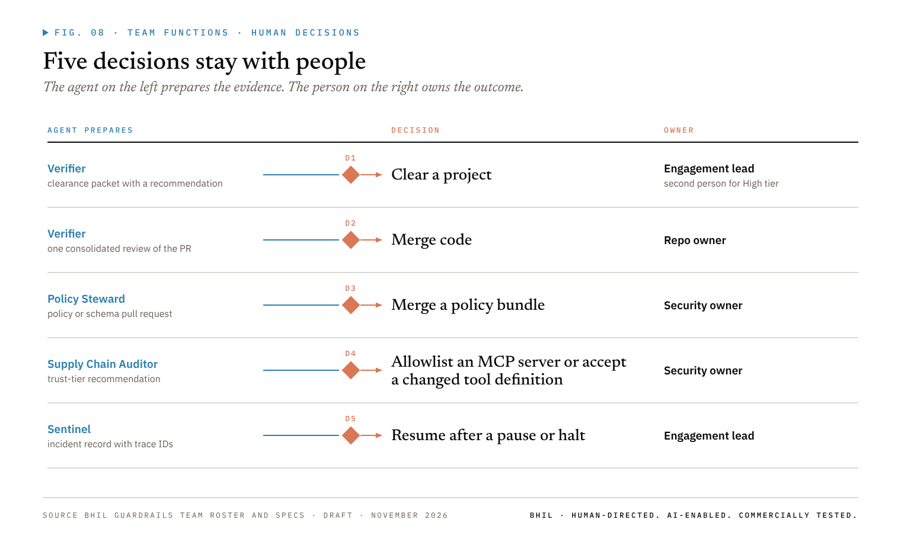
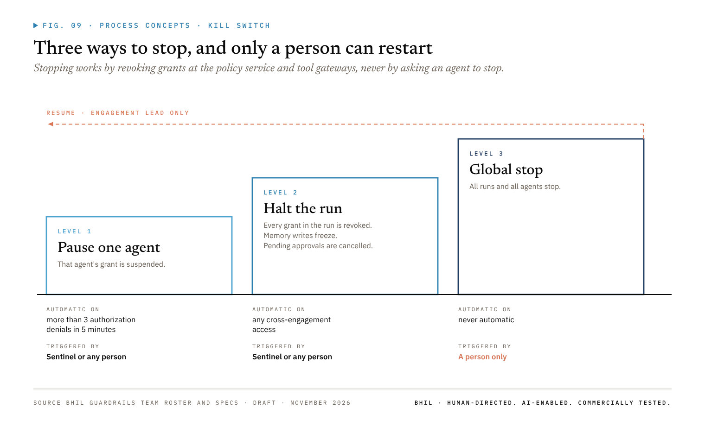

# Human decisions and the kill switch

## Five decisions stay with people



| ID | Decision | Agent that prepares it | What the agent hands over | Owner |
| --- | --- | --- | --- | --- |
| D1 | Clear a project | Verifier | Clearance packet with a recommendation | Engagement lead; a second person for High tier |
| D2 | Merge code | Verifier | One consolidated review of the pull request | Repo owner |
| D3 | Merge a policy bundle | Policy Steward | Policy or schema pull request | Security owner |
| D4 | Allowlist an MCP server or accept a changed tool definition | Supply Chain Auditor | Trust-tier recommendation | Security owner |
| D5 | Resume after a pause or halt | Sentinel | Incident record with trace IDs | Engagement lead |

The agent prepares the evidence. The person owns the outcome. This is the same split BHIL uses for change control everywhere: the agent drafts, a person approves.

## What the person should be shown

Approval is only a control if the person can see what they are approving. Each packet or review puts these in front of the decider, in this order:

1. What was checked and what was not
2. The raw evidence for each finding, with its pointer and tier
3. Disagreements between agents
4. Open questions
5. The recommendation, last

Two habits protect against rubber-stamping. The Sentinel flags any approval made in under 10 seconds. And a sample of low-risk decisions should be reviewed after the fact; the playbook suggests 5 percent as a starting rate.

## The solo-operator gap

Three human roles appear in this design: engagement lead, repo owner and security owner. In a small practice one person may hold all three. That is workable for D2 to D5. It is not workable for D1 on High-tier projects, which calls for a second person.

There are two honest ways to handle this:

- Name a second approver for High-tier work. A trusted peer outside the engagement is enough.
- Record the gap. Write in the clearance packet that the second-person rule was not met and why the risk was accepted.

Leaving the field blank is the one option that is not acceptable.

## Three ways to stop



| Level | Name | Effect | Automatic on | Who can trigger |
| --- | --- | --- | --- | --- |
| 1 | Pause one agent | That agent's grant is suspended | More than 3 authorization denials in 5 minutes | Sentinel or any person |
| 2 | Halt the run | Every grant in the run is revoked; memory writes freeze; pending approvals are cancelled | Any cross-engagement access | Sentinel or any person |
| 3 | Global stop | All runs and all agents stop | Never automatic | A person only |

Only a person can resume. The Sentinel that halted a run cannot restart it, and the self-test proves that the reference implementation refuses the attempt.

The trigger values in the table are starting values from the BHIL playbook. Tune them on your own traffic.

## How stopping is enforced

A stop must not depend on an agent agreeing to stop. In the full design, the policy service revokes grants and the tool gateways refuse calls. An agent that keeps trying simply gets denials.

This repository ships a small stand-in, `tools/killswitch.py`:

```bash
python3 tools/killswitch.py status
python3 tools/killswitch.py pause red-team --by sentinel --reason "4 denials in 5 minutes"
python3 tools/killswitch.py halt --by sentinel --reason "cross-engagement read"
python3 tools/killswitch.py resume --by sentinel --reason "looks fine"       # refused
python3 tools/killswitch.py resume --by human:lead --reason "incident reviewed"
```

It keeps state in `.guardrails/state.json` and writes every action, including refused ones, to a hash-chained log. `status` reports whether the chain is intact. A harness calls `killswitch.may_run(agent)` before each agent call and skips the call when it returns false.

That stand-in shows the rules. It does not stop a process that ignores it. See [Status and evidence](09-status-and-evidence.md).

## After a stop

The incident record follows `templates/incident.md`. Before the engagement lead resumes a run:

1. Preserve the trace and the approval log
2. Classify the incident by BHIL-T ID
3. Add a case for it to the red-team corpus
4. Run the regression
5. Read the record

## Drills

A kill switch that has never been pulled should not be trusted. Run a drill at least monthly: halt a test run, confirm every agent call is refused, confirm the log chain is intact, then resume as a person. The self-test covers the logic on every commit; the drill covers the wiring.
