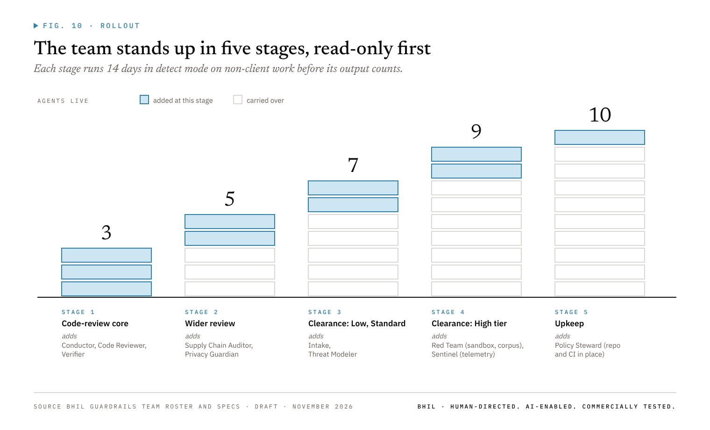

# Rollout

The team stands up in five stages, starting with the agents that can only read. Each stage runs 14 days in detect mode on non-client work before its output counts toward a real decision.

| Stage | Name | Adds | Agents live | What you can do after it |
| --- | --- | --- | --- | --- |
| 1 | Code-review core | Conductor, Code Reviewer, Verifier | 3 | Agent-drafted security review on every pull request, human merge |
| 2 | Wider review | Supply Chain Auditor, Privacy Guardian | 5 | Dependency, MCP and data-handling review on the pull requests that need it |
| 3 | Clearance: Low and Standard tiers | Intake, Threat Modeler | 7 | Scope manifests, risk tiers and threat tables for new projects |
| 4 | Clearance: High tier | Red Team, Sentinel | 9 | Adversarial testing and live monitoring; High-tier projects can be cleared |
| 5 | Upkeep | Policy Steward | 10 | Agent-drafted policy changes through pull requests |

## Why this order

Stage 1 is the smallest useful team and the lowest risk. Every agent in it is read-only or delegation-only, and the output is a review that a person was going to read anyway.

Stages 2 and 3 add more readers. Nothing in the first three stages can change a file or run a command.

Stage 4 adds the two agents that need infrastructure. The Red Team needs a sandbox with no network access and a corpus to run. The Sentinel needs telemetry to read. Neither is useful, or safe, before those exist.

Stage 5 adds the only agent that writes. It goes last so that the review loop and CI gates that check its pull requests are already running.

## Detect mode

In detect mode an agent's output is recorded and compared with what people decided, but it does not gate anything. Use the 14 days to answer three questions per stage:

1. How often did the agent's findings match what a person found?
2. How often did it raise something that turned out to be nothing?
3. How often did it miss something a person caught?

Do not move a stage out of detect mode on a feeling. Write the three answers down.

## Entry criteria per stage

| Stage | Before you start |
| --- | --- |
| 1 | Claude Code installed; this repository cloned; `tools/selftest.py` passes; a named repo owner |
| 2 | Stage 1 out of detect mode; a list of approved dependency and MCP sources |
| 3 | Stage 2 out of detect mode; a named engagement lead; `templates/scope.yaml` adopted |
| 4 | Stage 3 out of detect mode; a no-egress sandbox; a red-team corpus; telemetry the Sentinel can read; a second approver for High tier, or the gap recorded |
| 5 | Stage 4 out of detect mode; CODEOWNERS in force; the path guard hook registered; a named security owner |

## What must exist before any client work

The specifications assume a control plane: a policy service that mints and revokes grants, signed message envelopes, and per-agent telemetry. This repository contains reference code for the rules, not that control plane.

Until it exists:

- Grants are enforced only by each agent's tool allowlist
- The kill switch stops only a harness that asks it
- The Sentinel has only whatever logs you point it at

That is enough for stages 1 to 3 on BHIL's own repositories. It is not enough for High-tier client work.

## Open decisions

- [ ] Who holds engagement lead, repo owner, security owner and second approver
- [ ] Which repositories the Code Reviewer covers first
- [ ] Budget and time limits per run (the manifest carries placeholders)
- [ ] Where the red-team corpus lives and who curates it
- [ ] Final agent names (the current ones are working titles)
