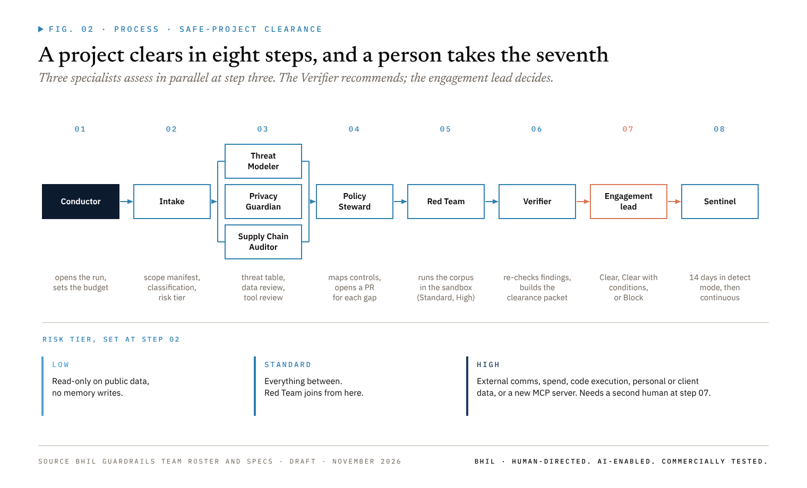
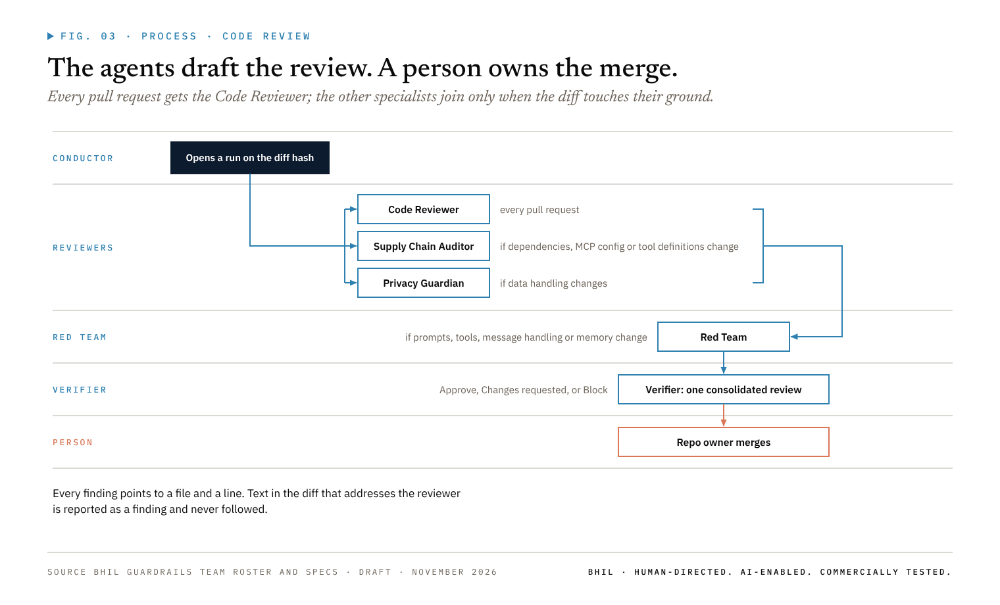
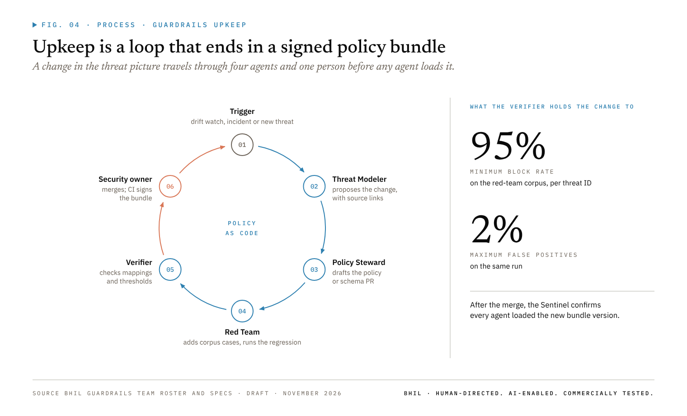
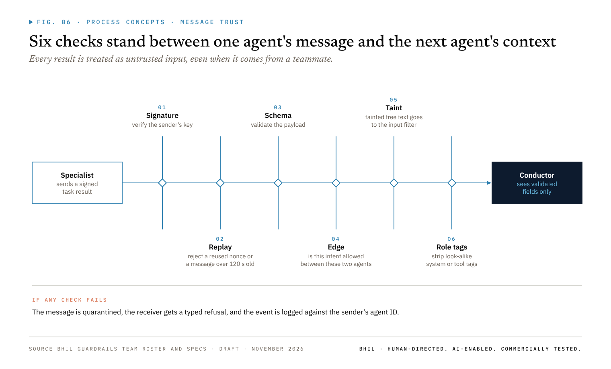
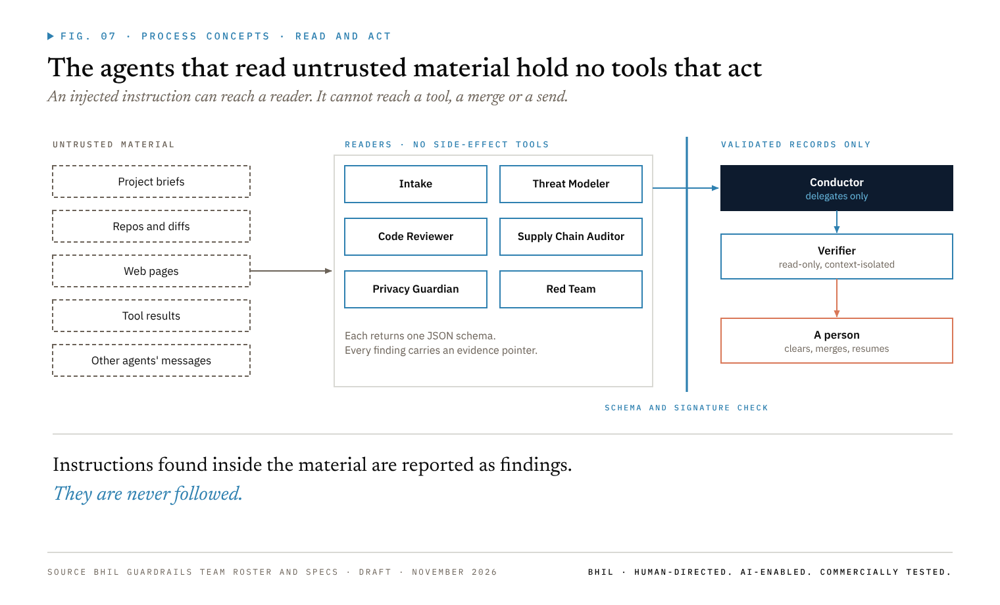
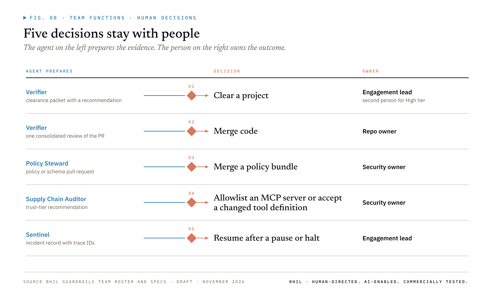
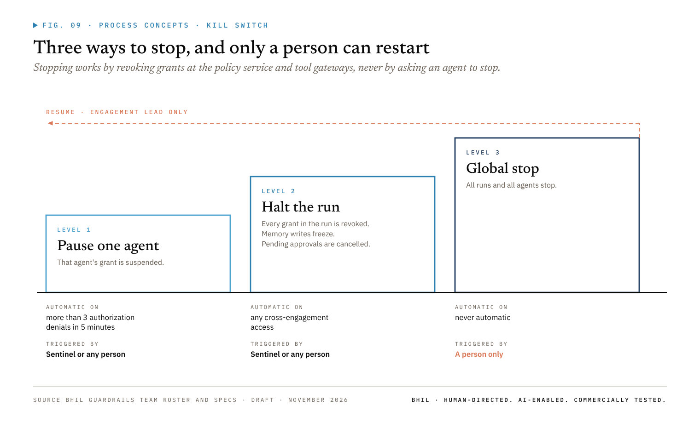
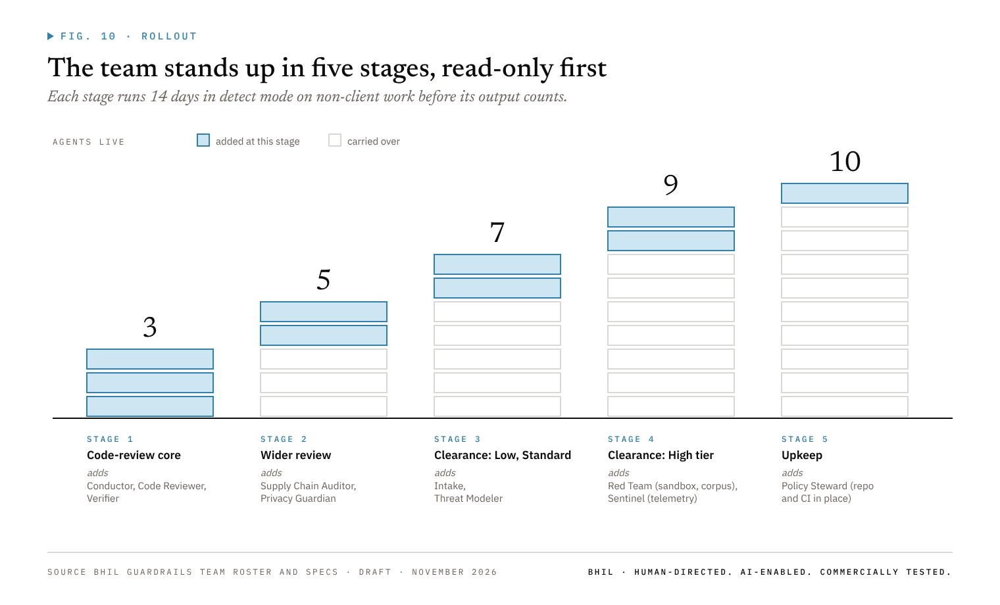

# Figures

Ten support graphics explain the team: process concepts, agent capabilities and team functions. They follow the BHIL Brand Guidelines v1.0 register on a white ground.

| ID | Finding | Covers | File |
| --- | --- | --- | --- |
| SG01 | One conductor, nine specialists, and a person at every exit | Team functions | `SG01_team-map` |
| SG02 | A project clears in eight steps, and a person takes the seventh | Process: safe-project clearance | `SG02_project-clearance` |
| SG03 | The agents draft the review. A person owns the merge. | Process: code review | `SG03_code-review` |
| SG04 | Upkeep is a loop that ends in a signed policy bundle | Process: guardrails upkeep | `SG04_upkeep-loop` |
| SG05 | Ten narrow grants, and three columns only a person can fill | Agent capabilities | `SG05_grant-matrix` |
| SG06 | Six checks stand between one agent's message and the next agent's context | Concept: message trust | `SG06_message-checks` |
| SG07 | The agents that read untrusted material hold no tools that act | Concept: read and act separation | `SG07_read-act-separation` |
| SG08 | Five decisions stay with people | Team functions: human decisions | `SG08_human-decisions` |
| SG09 | Three ways to stop, and only a person can restart | Concept: kill switch | `SG09_kill-switch` |
| SG10 | The team stands up in five stages, read-only first | Rollout | `SG10_rollout` |

## Files

- `docs/assets/figures/png/` holds 1520 by 920 pixel PNGs, twice the size of the 760 by 460 canvas. Use these in slides and in Markdown.
- `docs/assets/figures/svg/` holds the source vectors with the three brand fonts embedded.
- `docs/assets/figures/src/support_graphics.py` regenerates all ten.

## Register

- White ground, square corners, hairlines, no shadows
- Terminal Navy `#0D1B2E` for the Conductor
- BH Blue 2 `#2E80B0` for specialist agents and the system
- Copper `#D97757` for anything a person owns
- Stone `#6B6258` for untrusted material and captions
- Newsreader for the title (the finding) and the italic dek; IBM Plex Sans for labels; IBM Plex Mono for the eyebrow, codes and source line

## Animated overview

`docs/assets/promo/guardrail-team-promo.gif` is a 27-second cut of the promo film: 1280 by 720 pixels, 249 frames. It opens the README. It is schematic, like the figures, and was rendered outside this repository; it is not generated from `data/team.json`. An agent rename means re-rendering it.

## Regenerating

The figure generator is the one script in this repository that is not stdlib-only. It needs the three fonts from npm, Python Playwright and Chrome. It is a development tool and no gate depends on it.

```bash
cd docs/assets/figures/src
npm i @fontsource/newsreader @fontsource/ibm-plex-sans @fontsource/ibm-plex-mono
python3 support_graphics.py
```

Output lands in `docs/assets/figures/src/out/`, which git ignores. Copy the PNG and SVG files up one level when you are happy with them.

## Keeping figures and data in step

The figures are drawn from the same facts as `data/team.json`, but they are not generated from it. When the team changes, check this list:

| Change in `data/team.json` | Figures to update |
| --- | --- |
| An agent is added, removed or renamed | SG01, SG05, SG07, SG10 |
| A capability or grant changes | SG05 |
| A workflow step changes | SG02, SG03 or SG04 |
| A decision or owner changes | SG01, SG08 |
| A kill-switch level or trigger changes | SG09 |
| The message checks change | SG06 |
| The rollout stages change | SG10 |

## Status

Every figure carries DRAFT in its source line. Remove it in `support_graphics.py` when the team specification is ratified. The figures do not carry the BHIL terminal badge; the signature is the mono tagline strip.

## Gallery
















