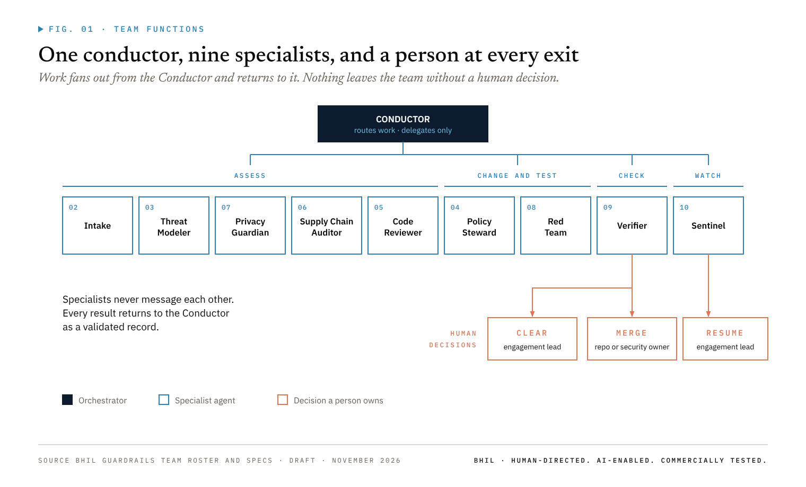

# BHIL Agent Guardrail Team

REF GUARDRAIL-001 · version 0.1.0 · DRAFT

Ten agents that run BHIL's guardrails as one team. The team has three jobs: clear projects as safe to run, review code before a person merges it, and keep the guardrails structure current.

## Start here

| If you want to | Read |
| --- | --- |
| Understand the team in five minutes | [Overview](01-overview.md) |
| See how work moves | [Workflows](02-workflows.md) |
| Know the rules every agent runs under | [Team rules](03-team-rules.md) |
| Know what stays with people | [Human decisions and the kill switch](04-human-decisions-and-kill-switch.md) |
| See which threats the team is built against | [Threat model](05-threat-model.md) |
| Run the agents in Claude Code | [Claude Code setup](06-claude-code-setup.md) |
| Plan the stand-up | [Rollout](07-rollout.md) |
| Reuse the graphics | [Figures](08-figures.md) |
| Check what is proven and what is not | [Status and evidence](09-status-and-evidence.md) |

## The five rules the design rests on

1. An agent that reads untrusted material holds no tools that act.
2. The Conductor delegates and does nothing else.
3. The Verifier shares no context with the agents whose work it checks.
4. Every message between agents is typed, signed and treated as untrusted input.
5. Stopping is done by revoking grants, never by asking an agent to stop.

## One source of truth

Everything about the team lives in `data/team.json`. The agent files, the swarm manifest and the reference pages are generated from it by `tools/build.py`. A drift gate fails the build if any generated file is edited by hand.

Human-directed. AI-enabled. Commercially tested.
